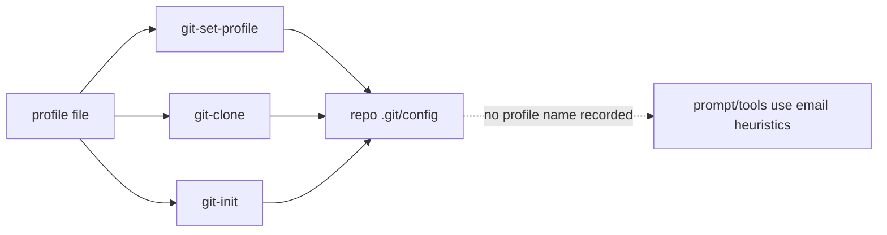
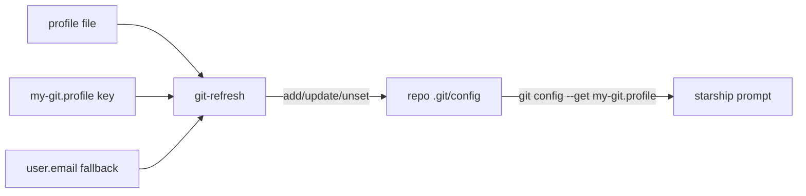

# Architecture Proposal: Explicit Profile Tracking and git-refresh
<!-- Link base: write relative links with the repository root as the base. -->

> **Note:** This proposal follows the workflow defined in [ARCHITECT.md](agentic/ARCHITECT.md).

- **Author:** agent session
- **Created:** 2026-11-10
- **Status:** implemented
- **Implemented:** 2026-11-10

## 1. Summary

Record the active profile name in each repository's local Git config under
`my-git.profile`, and add a `git-refresh` tool that synchronizes a repository's
local configuration against its bound profile. This removes heuristic email
lookups from shell prompts and repairs configuration drift when profiles change.

## 2. Motivation

Two gaps exist today (see [docs/requests/refresh_n_config_profile.md](docs/requests/refresh_n_config_profile.md)):

- **No in-repo state tracking.** `.git/config` stores resolved values
  (`user.name`, `user.email`, `core.sshCommand`) but not the profile name.
  Shell prompts must scan profile files by email, which costs latency per
  prompt render.
- **Configuration drift.** `git-set-profile`, `git-clone`, and `git-init`
  write config once. When a profile later changes (rotated SSH key, new
  signing key, renamed user), existing repositories keep stale values.
  GitHub-side key replacement makes this a recurring event, not an edge
  case.

`docs/ARCHITECTURE.md` §5 records related debt: `git-clone` and `git-init`
duplicate parsing helpers instead of sourcing `my-git-core.inc.sh`.

## 3. Current Architecture

- `git-set-profile` applies `name`, `email`, `ssh_key`, `signing_key` from a
  profile file to the current repo's local config. It sources
  `my-git-core.inc.sh` and uses `parse_field` and `resolve_key_path`.
- `git-clone` and `git-init` apply the same fields after repository creation.
  They duplicate `parse_field` and `resolve_key_path` inline.
- `my-git-core.inc.sh` provides `parse_field`, `resolve_key_path`,
  `find_profile_by_email`, `resolve_token`, `protect_profile_tokens`, and
  the `MY_GIT_*` directory variables.
- `install-my-git` copies every name in its `TOOLS` array plus
  `my-git-core.inc.sh` into the target bin directory.
- `my-git-completion.bash` registers completions per tool.
- Tests live in `tests/*.bats` (bats-core) with helpers in `tests/helpers/`.

All tools write the same SSH command format:
`ssh -i <key> -o IdentitiesOnly=yes`. `git-set-profile`, `git-clone`, and
`git-init` set `commit.gpgsign` and `tag.gpgsign` when a signing key exists.

## 4. Proposed Changes

### Structural changes

- Add `git-refresh` executable at repository root. It sources
  `my-git-core.inc.sh` and reuses `parse_field`, `resolve_key_path`, and
  `find_profile_by_email`.
- Add `"git-refresh"` to `TOOLS` in `install-my-git`.
- Add a `git-refresh` completion function in `my-git-completion.bash`.
- Add `tests/refresh.bats` covering the new tool.

### Data and type changes

- New local config key `my-git.profile = <name>` in `.git/config`. It is
  local-only and never pushed. All three setup tools write it:
  - `git-set-profile` writes it after applying config.
  - `git-clone` writes it via `git -C` or after `cd` into the target.
  - `git-init` writes it after `git init` and `cd`.
- `git-refresh` writes `my-git.profile` on every run, including when it
  resolved the profile through the email fallback.

### Behavior of `git-refresh`

1. Fail fast outside a Git worktree and when `$MY_GIT_PROFILES_DIR` is absent.
2. Resolve the profile:
   - Read `git config --local --get my-git.profile`. Use it when the profile
     file exists.
   - Otherwise fall back to `find_profile_by_email` against local
     `user.email`. On match, print a notice that the repo was bound via
     email, then write `my-git.profile`.
   - Otherwise exit non-zero with a hint to run `git-set-profile`.
3. For each managed key, compare desired vs current and apply updates.
   Report `[ADDED]`, `[UPDATED]`, or `[OK]` per key.
4. `--force` rewrites every managed key unconditionally.

Managed keys and parity rules:

- Always: `user.name`, `user.email`, `my-git.profile`.
- When `ssh_key` exists in the profile: `core.sshCommand` =
  `ssh -i <resolved> -o IdentitiesOnly=yes` (same format as setup tools).
- When `signing_key` exists: `gpg.format=ssh`, `user.signingkey`,
  `commit.gpgsign=true`, `tag.gpgsign=true`, and
  `gpg.ssh.allowedSignersFile` when the file exists.
- **Drift removal:** when the profile no longer defines `ssh_key` or
  `signing_key`, `git-refresh` unsets the corresponding local keys
  (`git config --local --unset`) so a deleted GitHub-side key does not
  leave broken config behind. It prints `[REMOVED]` per unset key.
- Missing key files on disk produce warnings, not errors.

### Integration changes

- Starship displays the profile through
  `git config --local --get my-git.profile` in a `[custom.git_profile]`
  block. This is user-side config documented in the request and README;
  no repo file changes.

## 5. Trade-offs

### Benefits

- **[Fast prompt lookup]:** One `git config` read replaces directory scans
  and email matching on every prompt render.
- **[Drift repair]:** `git-refresh` resynchronizes all repositories after
  profile edits or key rotation, including removal of stale keys.
- **[Self-healing legacy repos]:** The email fallback binds older
  repositories on first run without manual action.
- **[No parser duplication]:** `git-refresh` reuses `my-git-core.inc.sh`
  helpers, matching `git-set-profile`.

### Costs and Risks

- **[Key can lie]:** A user can hand-edit `my-git.profile` or `user.email`
  and bind the wrong profile. Mitigation: `--force` re-apply and clear
  `[UPDATED]` reporting.
- **[Unset semantics]:** Removing `core.sshCommand` or signing keys can
  surprise users who customized them post-setup. Mitigation: `[REMOVED]`
  output states each unset; `--force` is not required for removal.
- **[One more tool]:** Adds a binary, completion entry, and test suite.
  Low cost; follows existing per-tool layout.

### Alternatives Considered

- **[Email-only detection]:** Keep matching `user.email` without storing a
  key. Rejected: O(n) profile scans per prompt and ambiguous on duplicate
  emails.
- **[Store in a separate file]:** e.g., `.git/my-git-profile`. Rejected:
  `git config` already provides namespaced local state with a standard
  read path.
- **[Extend git-set-profile instead of new tool]:** Rejected:
  `git-set-profile` takes an explicit profile argument and does not
  auto-detect; a dedicated refresh command keeps both contracts clear.

## 6. Implementation Plan

Execution follows `agentic/WORKFLOW.md` at the Standard tier (public CLI
surface changes). Tasks transfer to `PLAN_git_refresh_profile_tracking.md`.

### Phase 1 — Record the binding in setup tools

- **Goal:** Every configured repo stores `my-git.profile`.
- **Files to touch:** `git-set-profile`, `git-clone`, `git-init`.
- **Approach:** Add one `git config --local my-git.profile "$PROFILE"` write
  per tool at the point where other local keys are applied. Include it in
  each tool's final `git config --local --list` display grep pattern.

### Phase 2 — Add `git-refresh`

- **Goal:** New tool that binds and resynchronizes the current repo.
- **Files to touch:** `git-refresh` (new).
- **Approach:** Source `my-git-core.inc.sh`; parse `-f|--force`/`-h|--help`;
  resolve profile (key → email fallback → error); diff-and-apply managed
  keys with `[ADDED]`/`[UPDATED]`/`[OK]`/`[REMOVED]` output; unset keys
  for profile fields that disappeared; warn on missing key files.

### Phase 3 — Installer and completion

- **Goal:** Distribute and complete the new tool.
- **Files to touch:** `install-my-git`, `my-git-completion.bash`.
- **Approach:** Append `"git-refresh"` to `TOOLS`; add
  `_git_refresh_complete` completing `--force -f --help -h`.

### Phase 4 — Tests and docs

- **Goal:** Cover the Testing Triad and document the feature.
- **Files to touch:** `tests/refresh.bats` (new), `README.md`,
  `docs/ARCHITECTURE.md` (component list and §5 debt note update).
- **Approach:** bats tests per §7 using `tests/helpers/`; README section on
  `my-git.profile` and `git-refresh`; note Starship snippet as user config.

## 7. Testing Strategy

- **Unit tests (`tests/refresh.bats`):**
  - Happy path: repo bound via `my-git.profile`; changed profile values
    produce `[UPDATED]`; identical values produce `[OK]`; `--force`
    rewrites.
  - Binding: missing key + matching `user.email` prints notice and writes
    `my-git.profile`.
  - Drift removal: profile without `signing_key` unsets
    `user.signingkey`/`commit.gpgsign`/`tag.gpgsign`/`gpg.format` with
    `[REMOVED]` output.
  - Negative: outside worktree → exit 1; no profile match → exit 1 with
    hint; unknown option → exit 1; missing key file → warning, run
    continues.
- **Integration tests:** `git-set-profile`/`git-clone`/`git-init` write
  `my-git.profile` (extend `tests/set_profile.bats` and clone/init cases);
  installer copies `git-refresh` (`tests/install.bats`).
- **Invariant checks:** `core.sshCommand` format stays
  `ssh -i <key> -o IdentitiesOnly=yes` across all four tools;
  `my-git.profile` never appears in global config; unset removal only
  touches managed keys.
- **Migration or rollback tests:** Legacy repo (email match, no key) gains
  the key on first `git-refresh` run — covered by the binding test.

These checks become Acceptance Criteria in `PLAN_git_refresh_profile_tracking.md`.

## 8. Open Questions

- **Starship symbol/format defaults** — `non-blocking`. The request shows a
  sample block; exact symbol and style remain user preference.
- **`allowed_signers` refresh** — `non-blocking`. `git-refresh` syncs the
  `gpg.ssh.allowedSignersFile` pointer but does not regenerate the file's
  contents; that remains `git-add-profile`/`git-protect` scope.
