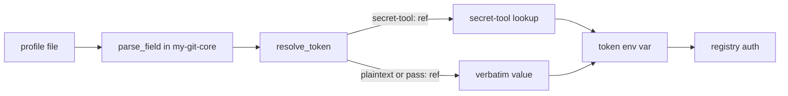

# Architecture Proposal: Adopt resolve_token Across my-git Tools
<!-- Link base: write relative links with the repository root as the base. -->

> **Note:** This proposal follows the workflow defined in [ARCHITECT.md](agentic/ARCHITECT.md).

- **Author:** agent session
- **Created:** 2026-11-10
- **Status:** implemented
- **Implemented:** 2026-11-10

## 1. Summary

`git-protect` moves plaintext profile tokens into the system keyring and rewrites
profile fields to `secret-tool:` references. The publish tools read these fields
verbatim, so publishing breaks after protection. This proposal makes
`my-git-core.inc.sh` the installed shared library, routes every token read through
`resolve_token`, consolidates duplicated helpers into it, and makes
`git-export-profile` resolve secrets back to plaintext on export while
`git-import-profile` gains a `--protect` option to re-secure imported profiles.

## 2. Motivation

After `git-protect` runs, `cargo_token`, `pypi_token`, and `docker_token` hold
`secret-tool:service=my-git,profile=
,token=<k>` strings. `git-cargo-publish`,
`git-pypi-publish`, `git-uv-publish`, and `git-docker-publish` pass these strings
to registries verbatim and fail. `resolve_token` exists in `my-git-core.inc.sh`
but nothing sources it, and `install-my-git` does not install the file. See
[docs/ARCHITECTURE.md](docs/ARCHITECTURE.md), Section 5.

## 3. Current Architecture

- `my-git-core.inc.sh` defines `resolve_token` for `secret-tool:` references.
- Each publish script carries a private copy of `parse_field` and reads its token
  field without resolution.
- `git-set-profile` and `git-export-profile` carry private copies of
  `resolve_key_path`.
- `install-my-git` copies only the tool executables and the completion file.

## 4. Proposed Changes

### Structural changes

- `my-git-core.inc.sh` becomes the shared library. It holds `resolve_token`,
  `parse_field`, `resolve_key_path`, `find_profile_by_email`, and a new
  `protect_profile_tokens` helper extracted from `git-protect`.
- `git-cargo-publish`, `git-pypi-publish`, `git-uv-publish`, `git-docker-publish`,
  `git-set-profile`, `git-export-profile`, `git-import-profile`, and `git-protect`
  source `my-git-core.inc.sh` from the script directory and drop local duplicates.
- `install-my-git` installs `my-git-core.inc.sh` into the target bin directory and
  aborts when the source file is missing.

### Data and behavior changes

- Publish tools wrap token fields in `resolve_token` after `parse_field`. Empty
  resolution falls into the existing "token not defined" error path.
- `pass:` references pass through `resolve_token` unchanged. They are already
  secured external references.
- `git-export-profile` resolves `secret-tool:` fields back to plaintext in the
  staged profile copy before archiving. The AES-256-CBC archive protects the
  plaintext. Export becomes portable across machines.
- `git-import-profile` imports profiles as stored (plaintext). A new `--protect`
  flag runs `protect_profile_tokens` on each imported profile.

### Concurrency and state changes

None. The scripts remain single-process sequential Bash.

### Integration changes

- `install-my-git` gains a runtime file dependency: every tool now requires the
  sibling `my-git-core.inc.sh` at runtime. Uninstall or relocation must keep the
  pair together.

## 5. Trade-offs

### Benefits

- **Correctness:** publishing works on protected profiles.
- **Single resolution point:** token handling lives in one function, not five
  script copies.
- **Portability:** exports contain plaintext inside an encrypted archive, so
  imports work on machines without the original keyring.
- **Opt-in protection:** `--protect` on import restores the protected state in
  one step.

### Costs and Risks

- **Sibling-file dependency:** a tool fails if `my-git-core.inc.sh` is missing or
  stale next to it. Mitigation: `install-my-git` always installs both together;
  tools fail fast with a clear message when the include is absent.
- **Plaintext on export:** resolution happens in the staging directory before
  encryption. Mitigation: the existing `mktemp -d` plus `trap rm -rf` pattern
  already bounds the exposure window.
- **Refactor blast radius:** deduplicating helpers touches most scripts.
  Mitigation: behavior-preserving extraction, then consumer updates.

### Alternatives Considered

- **Inline resolve_token per script:** rejected; duplicates the logic that this
  proposal exists to unify.
- **Export keyring entries too:** rejected; libsecret entries are host- and
  session-bound, not portable.

## 6. Implementation Plan

Execute under the Planning and Execution Workflow in `agentic/WORKFLOW.md`.
This change touches shared state across tools and the install contract, so the
plan uses the Standard tier in `project/PLAN_resolve_token_adoption.md`.

- **Phase 1 — Shared library.**
  - Goal: `my-git-core.inc.sh` exposes `resolve_token`, `parse_field`,
    `resolve_key_path`, `find_profile_by_email`, `protect_profile_tokens`.
  - Files: `my-git-core.inc.sh`, `git-protect`.
  - Approach: move helpers verbatim, then extract the token-migration block from
    `git-protect` into `protect_profile_tokens`; `git-protect` calls it.

- **Phase 2 — Installer.**
  - Goal: `install-my-git` installs and validates `my-git-core.inc.sh`.
  - Files: `install-my-git`.
  - Approach: add the file to source validation; copy it to the bin directory.

- **Phase 3 — Publish tools.**
  - Goal: all token reads flow through `resolve_token`.
  - Files: `git-cargo-publish`, `git-pypi-publish`, `git-uv-publish`,
    `git-docker-publish`.
  - Approach: source the include, replace local `parse_field` copies, wrap token
    extraction in `resolve_token`.

- **Phase 4 — Remaining consumers.**
  - Goal: `git-set-profile`, `git-export-profile`, `git-import-profile` use shared
    helpers.
  - Files: `git-set-profile`, `git-export-profile`, `git-import-profile`.
  - Approach: source the include, drop local `resolve_key_path`/`parse_field`
    copies; in export, resolve `secret-tool:` fields when staging profiles; in
    import, add `--protect` flag invoking `protect_profile_tokens`.

- **Phase 5 — Documentation.**
  - Goal: README and `docs/ARCHITECTURE.md` reflect the new flow.
  - Files: `README.md`, `docs/ARCHITECTURE.md`.

## 7. Testing Strategy

- **Unit tests:** `resolve_token` returns plaintext verbatim, resolves a mocked
  `secret-tool` lookup, returns empty on lookup failure, and passes `pass:` refs
  through unchanged. `protect_profile_tokens` rewrites only the three token keys
  and skips `secret-tool:`/`pass:` values.
- **Integration tests:** end-to-end script run per publish tool with a stubbed
  `secret-tool` on PATH confirming the resolved token reaches the subprocess env;
  export→import round trip confirms plaintext export and `--protect` re-securing.
- **Invariant checks:** no script defines a private `parse_field` or
  `resolve_key_path` after the change; every tool sources `my-git-core.inc.sh`;
  tokens never appear in command-line arguments.
- **Migration tests:** a profile written by current `git-protect` output resolves
  identically after the refactor.

These checks become Acceptance Criteria in `project/PLAN_resolve_token_adoption.md`
(local-only file; referenced by name, not linked).

## 8. Open Questions

- Should `git-clone`/`git-init` also source the shared include for future shared
  helpers? — non-blocking; out of scope unless they need profile access.
- Should `install-my-git` support a dev mode symlinking `my-git-core.inc.sh`
  alongside symlinked tools? — non-blocking; current installer copies files.
